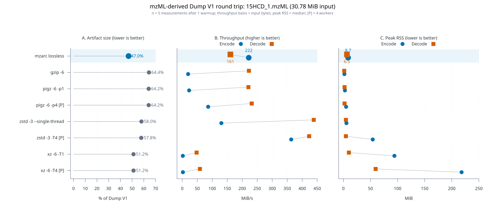

<!-- markdownlint-disable MD033 MD041 -->

<p align="center">
  
</p>

<p align="center">
  Domain-specific compression for mzML-derived mass spectrometry spectra.<br />
  On the current reference file: 75.55 MiB mzML to a 14.46 MiB lossless archive with an exact retained-field round trip.
</p>

<p align="center">
  <a href="#quick-start"></a>
  <a href="#format-and-validation"></a>
  <a href="CHANGELOG.md#030---2026-08-13"></a>
  <a href="https://github.com/eneskemalergin/mzarc/actions/workflows/ci.yml"></a>
  <a href="LICENSE"></a>
</p>

<p align="center">
  <a href="CHANGELOG.md"></a>
  <a href="https://github.com/eneskemalergin/mzarc/blob/main/benchmark/report.md"></a>
  <a href="https://github.com/eneskemalergin/mzarc/issues"></a>
</p>

---

## What mzarc does

`mzarc` is a research codec for mass spectrometry data. It keeps the CLI natively single-threaded and reads mzML through [zmz](https://github.com/eneskemalergin/zmz), a Zig mzML library. It has two archive paths:

```text
mzML -> mzarc encode -> .mzarc -> mzarc decode -> mzML
mzML -> mzarc dump -> Dump V1 -> mzarc encode -> .mzarc -> mzarc decode -> Dump V1
```

- **mzML documents.** Exact mode restores the source file byte for byte. Lossy mode quantizes spectrum m/z (f64) and intensity arrays and changes nothing else; m/z arrays whose values are f32 stored as f64, as many instruments write them, come back exact: metadata, identifiers, other arrays, chromatograms, and XML text stay as they were, and decode rebuilds `encodedLength`, the index offsets, and `fileChecksum` for the new byte positions. The decoded document carries no marker of the lossy step; only the archive records it, so keep or label lossy outputs yourself. On the 75.55 MiB reference file, exact mode writes 31.77% of the source and lossy mode 20.10%.
- **Dump V1 spectra.** Spectrum-aware transforms and entropy coding compress the fields Dump V1 retains, one active block at a time, with a lossless mode and a controlled lossy intensity mode.

The `.mzarc` 1.0 format remains under development, so no mode is use-ready yet.

## Quick start

mzarc uses Zig 0.16.0 from `PATH`. The build reads zmz from a checkout beside this repository (`../zmz`). Building, testing, and running mzarc do not require Python.

```bash
zig build --release=fast
```

Archive an mzML document exactly or lossily, then restore it:

```bash
./zig-out/bin/mzarc encode input.mzML -o input.mzarc
./zig-out/bin/mzarc encode input.mzML -o input.lossy.mzarc --lossy
./zig-out/bin/mzarc decode input.mzarc -o restored.mzML
```

Check a lossy mzML round trip peak by peak: each value must be unchanged or carry the documented lossy transform within its bound.

```bash
./zig-out/bin/mzarc decode input.lossy.mzarc -o restored.lossy.mzML
./zig-out/bin/mzarc dump input.mzML -o input.bin
./zig-out/bin/mzarc dump restored.lossy.mzML -o restored.lossy.bin
./zig-out/bin/mzarc validate input.bin restored.lossy.bin --mode=mzml-lossy
```

Convert an mzML file to Dump V1, encode its retained spectra, and inspect the archive:

```bash
./zig-out/bin/mzarc dump input.mzML -o input.bin
./zig-out/bin/mzarc encode input.bin -o input.mzarc
./zig-out/bin/mzarc inspect input.mzarc
```

Decode and validate a lossless round trip:

```bash
./zig-out/bin/mzarc decode input.mzarc -o restored.bin
./zig-out/bin/mzarc validate input.bin restored.bin --mode=lossless
```

The release build installs a stripped ReleaseFast binary for the host architecture's baseline CPU. It retains frame pointers and unwind metadata. Run `zig build` for a native-host Debug binary with symbols.

## Benchmark

The [reference report](https://github.com/eneskemalergin/mzarc/blob/main/benchmark/report.md) measures `15HCD_1.mzML` from PXD075509: 9,001 spectra and 2,668,458 peaks. Each operation has five measured samples after one warmup. Rows marked `[P]` use four workers; mzarc remains single-threaded.

| Representation                      | Size      | Relative to original mzML |
| ----------------------------------- | --------: | ------------------------: |
| Original mzML                       | 75.55 MiB |                   100.00% |
| mzarc exact archive of the document | 24.00 MiB |                    31.77% |
| mzarc lossy archive of the document | 15.18 MiB |                    20.10% |
| Dump V1 retained fields             | 30.78 MiB |                    40.74% |
| mzarc lossless archive of Dump V1   | 14.46 MiB |                    19.14% |

Against the shared Dump V1 input, mzarc writes a 14.46 MiB artifact, 46.99% of that input and 8.22% smaller than single-threaded xz. It records the fastest single-threaded encode at 214.86 MiB/s. zstd decodes faster, while gzip records lower peak RSS.

On the original document, the exact archive restores every byte at 31.77% of the input, 2.62% larger than single-threaded xz; it encodes at 110.07 MiB/s and decodes at 492.00 MiB/s with 1.04 MiB peak RSS. The lossy archive is 36.75% smaller than the exact one. Its largest observed errors are 0.000001 Da in m/z and 0.000643 in `log1p` intensity, against a format-wide limit of 0.005415.

<p align="center">
  
  <br /><em>Dump V1 comparison. Lower is better for size and RSS; higher is better for throughput.</em>
</p>

These are measured results from one file, one acquisition shape, and one host, taken under unrelated background load (load average 3.7 at the start, 7.3 at the end). The report records the commands, tool versions, validation boundaries, direct-child RSS, timing spread, the original-mzML and lossy comparisons, and `mzarc dump` ingest.

## Format and validation

Format 1.0 defines Dump V1, its numeric transforms, every stored field, and the reader rejection rules. The codec is single-threaded, preserves global scan order, and leaves an existing destination unchanged when encode or decode fails. It accepts at most 500,000 spectra and 500,000 blocks. Each block is limited to 128 spectra and 524,288 peaks, with derived payload limits checked before proportional allocation or read. These limits keep the measured 64-bit process below the 64 MiB release ceiling; final supported-host confirmation is still pending.

Lossless mode returns every accepted Dump V1 field with the same bits, including each supported f64 m/z value. Lossy m/z uses a nominal half-step of 0.000001 Da at the default scale, plus normal f64 operation rounding. The validator recomputes that transform and requires the decoded f64 bits to match. Intensity error is checked in `log1p` space; its format-wide limit depends on `--intensity-quant` and is about 0.5430% on `1 + intensity` at the default 16,384 levels. A custom validation level must match the value used for encoding.

Format 1.0 is not use-ready yet. Development archives may need regeneration, and compatibility with earlier development layouts is not promised.

Block checksums use CRC-32/ISO-HDLC from wthecksum `crc32`, a separate Zig library by the same author. It selects PCLMUL or VEX PCLMUL at run time on x86-64 and keeps a portable path for other processors. CI verifies Debug and ReleaseFast behavior on Ubuntu and macOS. Windows and aarch64 are not supported claims.

## Development

Run the focused and combined local gates with Zig 0.16.0:

```bash
zig build test --summary all
zig build ci --release=fast --summary all
```

The combined release gate runs ReleaseFast tests, verifies the frozen fixture, checks `mzarc dump` against a small mzML fixture, and exercises adversarial, lossless, and lossy CLI round trips against the stripped binary. It does not require Python or local mzML data.

The local comparison requires the peer tools described in the [repository tool notes](tools/README.md) and a local copy of the reference mzML file:

```bash
bash tools/benchmark.sh ~/Github/data/mzml/PXD075509/15HCD_1.mzML
```

Repository responsibilities stay narrow:

```text
src/         Zig codec and CLI
test/        Unit, property, malformed-input, fixture, and CLI data
tools/       Local benchmark, smoke, and reference-converter commands
benchmark/   Reference report, baseline row, and summary figures
```

Real-data inputs live outside the repository; the benchmark reads them from `~/Github/data/mzml` unless `MZARC_DATA` names another root.

The Zig source package contains the binary build, its tests, the license, and release notes. Benchmarks, peer binaries, and local development files remain repository-only.

## Roadmap

Current directions include:

- Finish supported-host memory and release checks before declaring `.mzarc` use-ready.
- Add native lossless and lossy mzML archives that restore the source document, not only the Dump V1 fields.
- Broaden correctness, performance, and memory checks across acquisition shapes, file sizes, and supported hosts.
- Keep improving archive size, throughput, and RSS where measurements show a material cost.
- Explore DIA-specific coding and native vendor-format readers when representative data and stable interfaces justify them.

Concurrency remains outside the current product scope.

## References

### Formats and compression

- Martens, L. et al. [mzML -- a community standard for mass spectrometry data](https://doi.org/10.1074/mcp.R110.000133). _Molecular & Cellular Proteomics_.
- Bhamber, R. S. et al. (2020). [mzMLb: a future-proof raw mass spectrometry data format based on standards-compliant mzML and optimized for speed and storage requirements](https://doi.org/10.1021/acs.jproteome.0c00192). _Journal of Proteome Research_.
- Duda, J. (2013). [Asymmetric numeral systems: entropy coding combining speed of Huffman coding with compression rate of arithmetic coding](https://arxiv.org/abs/1311.2540). _arXiv:1311.2540_.
- Giesen, F. (2014). [rANS notes](https://fgiesen.wordpress.com/2014/02/02/rans-notes/) and the [ryg_rans reference implementation](https://github.com/rygorous/ryg_rans).
- [ms-numpress](https://github.com/ms-numpress/ms-numpress) and [MScompress](https://github.com/chrisagrams/mscompress), mass-spectrometry compression peers.

### Data and tooling

- [PXD075509](https://www.ebi.ac.uk/pride/archive/projects/PXD075509), the current reference dataset.
- [Zig](https://ziglang.org), the language used for the codec, CLI, and tests.
- [zmz](https://github.com/eneskemalergin/zmz), the Zig mzML library behind `mzarc dump`.
- [zebrac](https://github.com/eneskemalergin/zebrac), the Linux measurement tool used by the reference report.

---

## License and acknowledgements

**mzarc is licensed under the MIT License.** See [LICENSE](LICENSE) for the full terms.

**mzarc stands on the shoulders of giants.** I am building the codec in Zig, but rewriting an idea does not erase where it came from. The list below records the design references and the logic mzarc uses from each. The full bibliography, external dependencies, and benchmark peers remain in [References](#references).

- **[rANS and `ryg_rans`](https://github.com/rygorous/ryg_rans)**
  - **Relationship:** Design reference, not vendored code.
  - **Credit:** Jarek Duda for asymmetric numeral systems and Fabian Giesen for the byte-aligned reference implementation and notes.
  - **Terms:** [`ryg_rans` is released into the public domain](https://github.com/rygorous/ryg_rans/blob/master/LICENSE).
  - **Logic used:** The reverse-order encoder, state update, and byte-renormalization model behind order-0 rANS.
  - **How it is used:** `src/rans.zig` implements a local 32-bit rANS codec with 12-bit frequency precision, its own normalized frequency table and wire layout, and mzarc-specific validation.

---

<p align="center">
  <em>Ions drift to ground</em><br />
  <em>Folded into bit-packed frames -</em><br />
  <em>The machine breathes light.</em>
</p>
